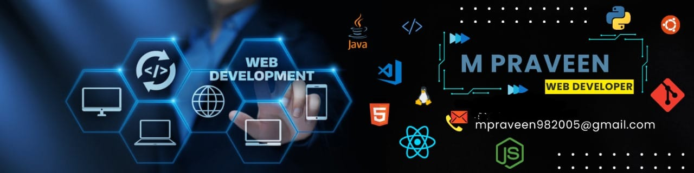

<!-- ====================================================== -->
<!--                 ANIMATED PROFILE HEADER                -->
<!-- ====================================================== -->

 

 

 

 

---

<!-- ====================================================== -->
<!--                       ABOUT ME                          -->
<!-- ====================================================== -->

## 👨‍💻 About Me

 

Hello! I'm **M. Praveen**, an aspiring software engineer and full-stack web developer from **Tamil Nadu, India**.

I'm passionate about designing and developing modern, responsive, and user-friendly web applications. I enjoy working across the full development lifecycle, from creating interactive frontend interfaces to building backend services and integrating databases.

My focus is on developing practical digital solutions using modern web technologies, clean code, and thoughtful user experiences.

### 🚀 What I Do

- 🎨 Build responsive and interactive user interfaces.
- ⚛️ Develop frontend applications using React.js and TypeScript.
- ⚙️ Create backend services using Node.js and Express.js.
- 🗄️ Integrate MongoDB and MySQL databases.
- 🔐 Implement authentication and protected application routes.
- 🔌 Develop and integrate RESTful APIs.
- 💬 Explore real-time communication applications.
- 🛠️ Use Git and GitHub to manage source code.
- 🌱 Continuously improve my software development and problem-solving skills.

### 💡 My Development Philosophy

> Build with purpose. Write clean code. Learn continuously. Create meaningful digital experiences.

---

<!-- ====================================================== -->
<!--                   DEVELOPER SNAPSHOT                    -->
<!-- ====================================================== -->

## ⚡ Developer Snapshot

| Category | Details |
|:---|:---|
| 👨‍💻 Professional Focus | Full Stack Web Development |
| 🎨 Frontend | React.js, JavaScript, TypeScript, HTML5, CSS3 |
| ⚙️ Backend | Node.js, Express.js, PHP, CodeIgniter |
| 🗄️ Databases | MongoDB, MySQL |
| 🔐 Authentication | JWT, bcrypt, protected routes |
| 🔌 API Development | RESTful APIs and API integration |
| 🧰 Tools | Git, GitHub, Postman, VS Code, Vite |
| 🏗️ Architecture | MVC and component-based development |
| 🌱 Current Focus | Scalable applications and software engineering practices |
| 📍 Location | Tamil Nadu, India |

---

<!-- ====================================================== -->
<!--                   TECHNICAL SKILLS                      -->
<!-- ====================================================== -->

## 🧰 Technical Skills

### 💻 Programming Languages

### 🎨 Frontend Development

- Responsive web design
- Reusable React components
- React hooks and component-based development
- JavaScript and TypeScript development
- Interactive interfaces and form handling
- Tailwind CSS and Bootstrap
- Mobile-friendly layouts

### ⚙️ Backend Development

- RESTful API development
- Server-side application logic
- Authentication and authorization workflows
- Middleware implementation
- CRUD operations
- Frontend and backend integration
- MVC-based application development

### 🗄️ Database Technologies

- MongoDB document-based storage
- MySQL relational databases
- Database integration
- Data modeling
- CRUD operations
- Application data management

### 🔐 Authentication & Communication

### 🛠️ Tools & Workflow

| Skill Area | Technologies |
|:---|:---|
| Languages | JavaScript, TypeScript, Python, PHP |
| Frontend | React.js, HTML5, CSS3, Bootstrap, Tailwind CSS |
| Backend | Node.js, Express.js, CodeIgniter |
| Databases | MongoDB, MySQL |
| Authentication | JWT, bcrypt, protected routes |
| Communication | REST APIs, Socket.IO, WebSockets |
| Tools | Git, GitHub, Postman, VS Code, Vite |
| Architecture | MVC, component-based development |
| Core Concepts | OOP, CRUD, authentication, authorization |

---

<!-- ====================================================== -->
<!--                    FEATURED PROJECTS                    -->
<!-- ====================================================== -->

## 🚀 Featured Projects

A selection of web development projects demonstrating my experience with frontend development, backend integration, database management, authentication, and application workflows.

### 01. 🌐 WebStacker — Developer Portfolio

A personal portfolio website showcasing my development skills, projects, certifications, and professional profile.

**Key Features**
- Modern developer-focused landing page
- Project showcase and technical skills sections
- Professional profile and experience presentation
- Responsive user interface
- Contact and portfolio navigation

**Technologies:** React.js, TypeScript, Tailwind CSS, Vite

**Live Website:** [stackerdev.netlify.app](https://stackerdev.netlify.app/)

---

### 02. 🛒 E-Commerce Web Application

A web application designed to support product browsing and essential online shopping workflows.

**Key Features**
- Product listing and browsing
- Shopping cart functionality
- Order management workflows
- User authentication
- Administrative product management
- Database-backed application functionality

**Technologies:** PHP, MySQL, MVC Architecture, HTML, CSS, JavaScript

**Core Concepts:** CRUD operations, relational databases, server-side processing, and application routing.

---

### 03. 💬 Real-Time Chat Application

A real-time messaging application designed to support interactive communication between users.

**Key Features**
- Real-time message exchange
- User authentication
- Online and offline status functionality
- Image-sharing integration
- Backend API integration
- Database-backed user and message data

**Technologies:** React.js, Node.js, Express.js, Socket.IO, MongoDB, JWT, Cloudinary

**Core Concepts:** Event-driven communication, WebSockets, authentication, and real-time application development.

---

### 04. 🔐 Secure User Authentication System

A full-stack authentication application focused on secure account access and protected application routes.

**Key Features**
- User registration and login
- Password hashing with bcrypt
- JWT-based authentication
- Protected routes
- Authentication middleware
- REST API integration

**Technologies:** React.js, Node.js, Express.js, MongoDB, JWT, bcrypt

**Core Concepts:** Authentication, authorization, middleware, API security, and password storage.

---

### 05. 👥 Employee Management System

An employee management application designed to organize employee records and administrative workflows.

**Key Features**
- Employee record management
- Administrator and employee roles
- Salary management workflows
- Leave management workflows
- Role-based access control
- Database-backed record operations

**Technologies:** PHP, CodeIgniter, MySQL, AdminLTE

**Architecture:** Model-View-Controller (MVC)

---

### 06. 📊 Client Lead Management System — Mini CRM

A customer relationship management application designed to organize leads and support sales-related workflows.

**Key Features**
- Lead tracking and management
- Kanban-style workflow organization
- Customer information management
- Dashboard and analytics concepts
- Lead status organization
- Structured user interface

**Technologies:** React.js, TypeScript, Tailwind CSS, Vite

**Core Concepts:** Workflow management, dashboard design, reusable components, and customer data organization.

---

### 07. 🏢 Business Website — Athletic Recovery & Wellness

A business website concept for an athletic recovery and wellness center.

**Key Features**
- Premium business-focused presentation
- Service information and branding
- Responsive web layout
- Appointment booking interface
- Customer-focused navigation

**Technologies:** React.js, TypeScript, Tailwind CSS, Vite

**Core Concepts:** Business website development, responsive UI, usability, and service presentation.

---

## 🧩 My Project Development Approach

- **Reusable components:** Building organized and maintainable frontend components.
- **API integration:** Connecting frontend interfaces with backend services.
- **Database integration:** Storing and retrieving application data.
- **Authentication:** Managing user access and protected resources.
- **Responsive design:** Supporting different screen sizes and devices.
- **Version control:** Tracking development changes using Git and GitHub.
- **Maintainability:** Writing structured, understandable code.

---

<!-- ====================================================== -->
<!--                  INTERNSHIP EXPERIENCE                  -->
<!-- ====================================================== -->

## 💼 Internship Experience

### 🚀 Full Stack Web Development Intern — Future Interns

**May 2026 – June 2026**

Worked on practical web development projects involving frontend interfaces, application workflows, and responsive design.

**Key Contributions**
- Developed a personal developer portfolio using React.js and TypeScript.
- Worked on a Mini CRM application with lead tracking and Kanban workflow concepts.
- Developed a business website concept for an athletic recovery and wellness center.
- Used Tailwind CSS and Vite in frontend development workflows.
- Used Git and GitHub for version control and project management.

**Technologies:** React.js, TypeScript, Tailwind CSS, Vite, Git, GitHub

**Recognition:** Certificate of Completion and Letter of Recommendation.

---

### 💻 Full Stack Web Development Intern — Prodigy InfoTech

**Internship Dates:** Replace this line with the dates printed on your official certificate.

Worked on full-stack web application projects involving authentication, employee management, e-commerce, and real-time communication.

**Key Contributions**
- Developed full-stack application features.
- Implemented user authentication and protected routes.
- Worked on employee management workflows.
- Developed e-commerce application functionality.
- Worked with real-time communication features using Socket.IO.
- Integrated backend services with database operations.
- Practiced API development and application architecture.

**Technologies:** React.js, Node.js, Express.js, PHP, CodeIgniter, MongoDB, MySQL, JWT, Socket.IO

**Recognition:** Internship Certificate and Letter of Recommendation.

---

<!-- ====================================================== -->
<!--                    CERTIFICATIONS                       -->
<!-- ====================================================== -->

## 🏆 Certifications & Recognition

- 🥇 **Future Interns** — Full Stack Web Development Internship Certificate and Letter of Recommendation.
- 🥇 **Prodigy InfoTech** — Full Stack Web Development Internship Certificate and Letter of Recommendation.
- 📘 **Novi Tech** — Full Stack Development Course Certificate.
- 🤖 **Microsoft** — Fundamentals of Generative AI.
- 🧠 **Accent Techno Soft** — Prompt Engineering Certificate.
- 🎓 **International Conference on Innovative Research in Engineering Science** — Participant.

---

<!-- ====================================================== -->
<!--                      ACHIEVEMENTS                        -->
<!-- ====================================================== -->

## 🌟 Highlights

<table>
<tr>
<td align="center" width="33%">

### 💻

**Full Stack Development**

Practical experience with frontend interfaces, backend services, and databases.

</td>
<td align="center" width="33%">

### 🚀

**Internship Experience**

Exposure to web development workflows through internship projects.

</td>
<td align="center" width="33%">

### 🏅

**Professional Recognition**

Internship certificates and Letters of Recommendation.

</td>
</tr>
</table>

---

<!-- ====================================================== -->
<!--                    GITHUB ANALYTICS                     -->
<!-- ====================================================== -->

## 📈 GitHub Analytics

  

  

> **Note:** GitHub statistics are generated by external services and may occasionally be unavailable. Language statistics reflect repository contents rather than a complete measure of technical ability.

---

<!-- ====================================================== -->
<!--                     CURRENT GOALS                       -->
<!-- ====================================================== -->

## 🎯 Current Goals

- 🚀 Build more practical full-stack applications.
- ⚛️ Improve React.js and TypeScript development skills.
- 🛠️ Strengthen backend API design and database integration.
- 🔐 Improve application security and authentication practices.
- 🧠 Develop stronger problem-solving and software engineering skills.
- 🤝 Contribute to collaborative projects and open-source development.
- 💼 Pursue opportunities in full-stack development and software engineering.

---

<!-- ====================================================== -->
<!--                     LET'S CONNECT                       -->
<!-- ====================================================== -->

## 🤝 Let's Connect

I'm interested in connecting with developers, collaborating on projects, sharing technical knowledge, and exploring software development opportunities.

  

📍 **Tamil Nadu, India**

---

<!-- ====================================================== -->
<!--                     ANIMATED FOOTER                      -->
<!-- ====================================================== -->

 

**💙 Thanks for visiting my profile!**

If you find my projects interesting, consider giving them a ⭐

